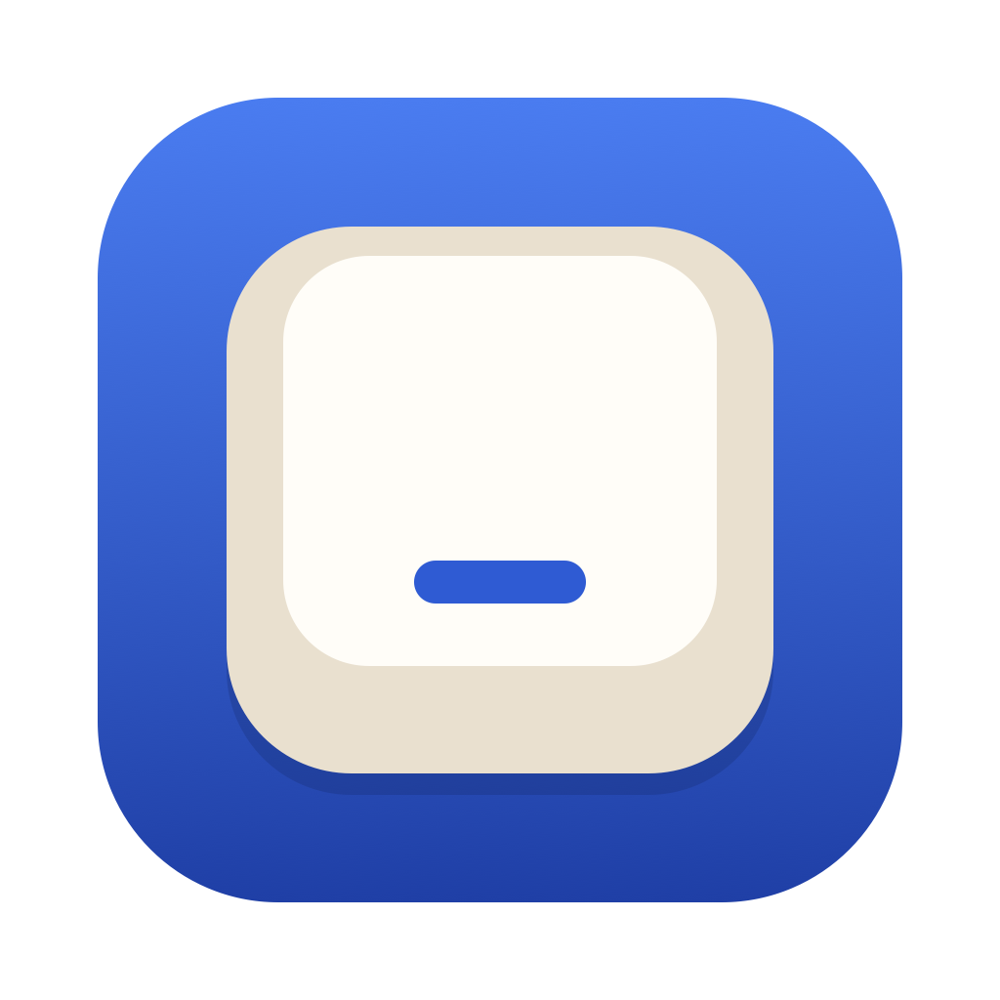
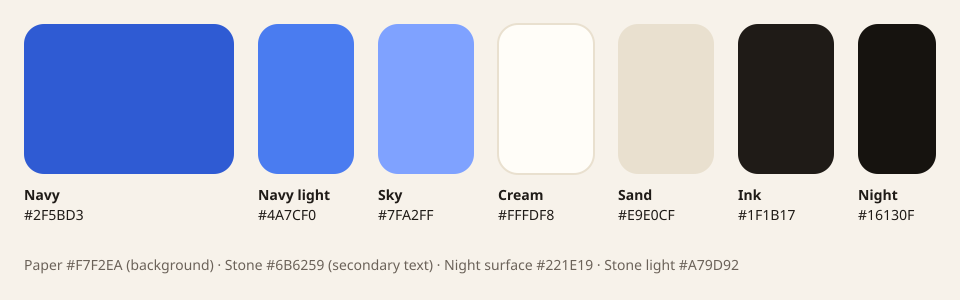

# Clicky brand

Everything needed to show Clicky in the app, in the repo and on a future website.
Edit the SVGs here; the PNGs and `Clicky.icns` are generated from them by
`scripts/build-brand.sh` and committed.

## The mark

A keycap seen from above, with the **homing bar**: the small ridge on the F and J
keys that your fingers find without looking. It says "keyboard" without a single
letter, and it is the one detail every typist knows.

| | File | Use |
|---|---|---|
|  | `logo/mark.svg` | Ink on light backgrounds. |
|  | `logo/mark-accent.svg` | Brand version on light backgrounds: ink keycap, navy bar. |
|  | `logo/mark-on-dark.svg` | On dark backgrounds: paper keycap, sky blue bar. |
|  | `logo/mark-template.svg` | Pure black: the macOS menu bar template. `crates/clicky/src/ui/status_item.rs` draws the same geometry in code. |

Geometry (18 × 18 grid): keycap 14.5 square at 1.75, corner radius 3.75, stroke 1.5;
homing bar from (6.75, 11.75) to (11.25, 11.75), stroke 1.6, round caps.

In the menu bar the bar means "sounds on": off shows the struck-through keycap
without it, and a missing permission shows an exclamation mark in its place.

Rules:

- The mark has no text. Never put letters inside the keycap.
- Clear space around it: at least a quarter of its width.
- Smallest size: 16 px (the menu bar draws it at 18 pt).
- One or two colours only, from the palette. No gradients, shadows or outlines on
  the mark itself (the app icon is the one place with depth).
- Don't rotate, stretch or redraw the keycap in perspective.

## App icon

| | File | Use |
|---|---|---|
|  | `app-icon/app-icon.svg` | Master, 1024 px on the macOS icon grid (824 px tile at 100 px). |
| | `app-icon/app-icon-small.svg` | Simplified artwork for 16 and 32 px: bigger keycap, heavier bar. |
| | `app-icon/Clicky.icns` | Generated; `cargo xtask bundle` copies it into `Clicky.app`. |
| | `app-icon/app-icon-1024.png` | Generated; for stores, README, press. |

A navy tile with a cream keycap: sand skirt, cream top face, navy homing bar. The
cream keycap on blue recalls the beige keyboards of old.
The icon shows in Finder, the About panel, System Settings (Input Monitoring, Login
Items) and the first-run window; the app has no Dock icon.

## Colour



| Name | Hex | Use |
|---|---|---|
| Navy | `#2F5BD3` | The homing bar, links and buttons on light (5.3:1 on Paper, Cream on it 5.8:1). |
| Navy light | `#4A7CF0` | Tile gradient top. Not for text (3.5:1 on Paper). |
| Navy deep | `#1F3FA6` | Tile gradient bottom; strong text on light (8.1:1 on Paper). |
| Sky | `#7FA2FF` | The accent on dark: the bar, links, buttons (7.5:1 on Night). Not on light (2.2:1). |
| Cream | `#FFFDF8` | Keycap top face, cards on light. |
| Paper | `#F7F2EA` | Page background (light). |
| Sand | `#E9E0CF` | Keycap skirt, borders, quiet surfaces. |
| Ink | `#1F1B17` | Text and the mark (15.4:1 on Paper). |
| Stone | `#6B6259` | Secondary text on light (5.4:1 on Paper). |
| Stone light | `#A79D92` | Secondary text on dark (7.0:1 on Night). |
| Night | `#16130F` | Page background (dark). |
| Night surface | `#221E19` | Cards on dark. |

Tile gradient: `#4A7CF0` → `#1F3FA6`, top to bottom. Ratios are WCAG 2 contrast.
Buttons: Navy with Cream text on light (5.8:1); Sky with Night text on dark (7.5:1).

## Type

System faces only, so there is nothing to license or download:

- Display (headings, the name): `ui-rounded` (SF Pro Rounded on Apple devices).
  Its round terminals echo the keycap's corners.
- Text: `system-ui`.
- Code and key names: `ui-monospace`.

The name, when written out, is **clicky.rs** in lowercase, set in the display face,
bold, with `.rs` in Navy (Sky on dark). It is live text next to the mark,
never part of it. Keep it as text, not outlines: the system font is not ours to
ship as artwork.

## Web

`tokens.css` (CSS custom properties, light and dark) and `tokens.json` (the same
values, for other tools) hold the palette, type stacks and corner radii.

```html
<link rel="icon" href="/favicon.svg" type="image/svg+xml">
<link rel="apple-touch-icon" href="/apple-touch-icon.png">
<meta name="theme-color" content="#F7F2EA" media="(prefers-color-scheme: light)">
<meta name="theme-color" content="#16130F" media="(prefers-color-scheme: dark)">
```

`web/favicon.svg` is the small app icon cropped to its tile; `web/apple-touch-icon.png`
(180 px, from its SVG) is a full-bleed square, because iOS rounds the corners itself.

## Regenerating

```sh
scripts/build-brand.sh
```

Rebuilds `app-icon/Clicky.icns` (16 and 32 px from the small artwork, the rest from
the master), `app-icon/app-icon-1024.png` and `web/apple-touch-icon.png`. Needs the
Xcode command line tools (`swiftc`) and `iconutil`, both already required to build.
